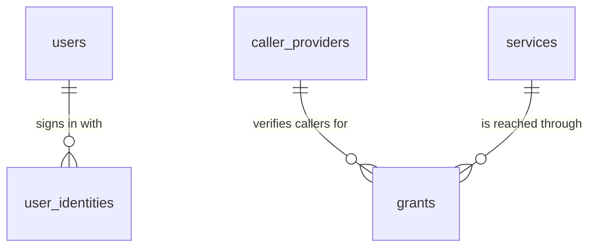

# Architecture

This page describes how cloudflare-tokengate is built: its components, the proxy pipeline, the data model and the source layout. It is for security reviewers and contributors.

The code is the reference. Each section names the files that implement it. Invariant IDs such as [I-CRED-2](threat-model.md#i-cred-2) are defined in [threat-model.md](threat-model.md). Terms follow the glossary in [concepts.md](concepts.md). Design decisions and their reasons are in the [ADRs](adr/README.md).

## Components

tokengate is one Cloudflare Worker with two D1 databases. Each company deploys its own copy in its own Cloudflare account.


<sub>Diagram source: [`diagrams/src/`](diagrams/src/) (rendered with [archify](https://github.com/tt-a1i/archify)).</sub>

| Component | Binding or route | Role |
|---|---|---|
| Proxy | `ANY /proxy/:slug`, `ANY /proxy/:slug/*` | Verifies the caller token, authorizes the request, injects the credential and forwards. |
| Admin UI | `/admin/*` | Server-rendered pages in four sections: Monitoring (`/admin`), Users (`/admin/users`), Service tokens (`/admin/tokens`) and Service consumers (`/admin/consumers`, with consumer access at `/admin/access`); `apps/gateway/src/admin/paths.ts` builds every URL ([ADR 0019](adr/0019-admin-information-architecture.md)). Every request is authenticated by its Cloudflare Access JWT; there are no gateway sessions and no `/auth` routes ([ADR 0015](adr/0015-cloudflare-access-only-admin-login.md)). |
| Health | `GET /healthz`, `GET /readyz` | Liveness without I/O; readiness as booleans only. See [observability.md](observability.md). |
| Static files | `/static/*` (Workers Assets, binding `ASSETS`) | `apps/gateway/public/static/app.css`. `run_worker_first` sends every other path to the Worker. |
| Cron | `scheduled`, `7 * * * *` | Rollups, retention purge, credential-expiry notices, heartbeat. |
| Queue consumer | `queue`, binding `REQUEST_LOG_QUEUE` (optional) | Batches request records into `TELEMETRY_DB`. |
| Control plane | D1 binding `DB` | Users, caller providers, services, grants, settings, audit log. |
| Telemetry | D1 binding `TELEMETRY_DB` | Request log and hourly rollups. |
| Archive | Pipelines binding `REQUEST_ARCHIVE` (optional) | Streams every request record to R2. |
| Rate limiter | Rate limiting binding `PROXY_RATE_LIMITER` (optional) | Caps requests per grant. |

All bindings, variables and secrets are listed in [configuration.md](configuration.md).

## Entry points

`apps/gateway/src/index.ts` exports three handlers. Each builds a `Deps` object (see [Dependency injection](#dependency-injection-and-tests)) and delegates:

- `fetch`: the Hono app from `apps/gateway/src/app.ts`.
- `scheduled`: `runCron` in `apps/gateway/src/telemetry/cron.ts`.
- `queue`: `consumeRequestLogBatch` in `apps/gateway/src/telemetry/queue-consumer.ts`.

`createApp()` in `apps/gateway/src/app.ts` registers routes in this order. The order matters:

1. A middleware that builds `Deps` for the request.
2. Proxy routes (`apps/gateway/src/proxy/routes.ts`). They come before the security middleware because proxy responses carry their own header policy.
3. The security middleware (`apps/gateway/src/http/security.ts`). It applies to every response outside `/proxy`: CSP without `script-src`, `nosniff`, `no-referrer`, HSTS on https, and `no-store` on `/admin`. It reads the admin hosts from D1 on every `/admin` request. It answers 404 for `/admin` on `workers.dev`, and, once the admin hosts are set, on any hostname that is not listed. A stored list that is not valid closes `/admin` on every hostname ([I-DEPLOY-1](threat-model.md#i-deploy-1)).
4. Health routes (`apps/gateway/src/health.ts`).
5. The admin middleware (`apps/gateway/src/admin/auth/middleware.tsx`).
6. Admin pages (`apps/gateway/src/admin/routes/index.ts`).
7. `GET /` redirects to `/admin`.

## Proxy pipeline

`handleProxy` in `apps/gateway/src/proxy/handler.ts` runs these steps in this order. A failing step returns a gateway error built by `gatewayError()` in `apps/gateway/src/lib/errors.ts`. Error codes are documented in [errors.md](errors.md). When the record reason differs from the error code, it is shown in brackets.

| Step | What happens | Module | Failure |
|---|---|---|---|
| 1 | Create the request id (`req_<ULID>`) and start the clock. | `apps/gateway/src/lib/ids.ts` | — |
| 2 | Check the method is in `PROXY_METHODS` (`GET HEAD POST PUT PATCH DELETE OPTIONS`). | `apps/gateway/src/policy/types.ts` | 405 `method_not_allowed` |
| 3 | Extract the caller token from `x-tokengate-token`, or from `Authorization` with scheme `Bearer` or `token`. Accept only one distinct compact JWS ([I-TOK-2](threat-model.md#i-tok-2)). | `apps/gateway/src/proxy/caller-token.ts` | 400 `token_ambiguous`, 401 `token_malformed` |
| 4 | Load the context in one D1 batch: the service by slug, enabled caller providers, matching grants, settings. If no token was found in step 3 and the service is enabled and uses `header` Injection, read the token from that header. Decode the token payload without verifying it. | `apps/gateway/src/db/proxy-context.ts` | 401 `token_missing`, 401 `token_malformed` |
| 5 | Select the caller provider whose `issuer` equals the unverified `iss`. The `iss` is only a lookup key. Resolve its profile. | `apps/gateway/src/identity/profiles/index.ts` | 401 `issuer_unknown`, 503 `not_configured` (`profile_unknown`) |
| 6 | Check the JWS header: `alg` is asymmetric and in the caller provider's list; `kid` is present and well-formed. | `apps/gateway/src/identity/jwt.ts` | 401 `token_malformed` |
| 7 | Verify signature and claims with jose: exact issuer, audience, max token age, required claims ([I-JWT-1](threat-model.md#i-jwt-1)). JWKS fetches are gated per `jwks_uri` ([I-JWT-2](threat-model.md#i-jwt-2)). | `apps/gateway/src/identity/jwt.ts` | 401 `signature_invalid`, `audience_mismatch`, `token_expired`, `token_too_old`, `claims_invalid`, `token_malformed`; 503 `jwks_unavailable` |
| 8 | Check the tenant pin ([I-TEN-1](threat-model.md#i-ten-1)). From here on, the caller is verified and its allowlisted claims may be stored ([I-LOG-2](threat-model.md#i-log-2)). | `apps/gateway/src/identity/jwt.ts` | 401 `tenant_mismatch` |
| 9 | Reveal whether the service exists. This happens only after step 8, so outsiders cannot list slugs. | `apps/gateway/src/proxy/handler.ts` | 404 `service_not_found` (`service_disabled` or `service_not_found`) |
| 10 | Canonicalize the caller path. Reject traversal and encoded variants ([I-PATH-1](threat-model.md#i-path-1)). | `apps/gateway/src/proxy/path.ts` | 400 `path_invalid` |
| 11 | Evaluate the grants of this caller provider: anchor rules, conditions, event guard, rules. Deny by default ([I-AUTHZ-1](threat-model.md#i-authz-1) to [I-AUTHZ-4](threat-model.md#i-authz-4)). | `apps/gateway/src/policy/evaluate.ts` | 403 `no_matching_grant`, 403 `event_not_trusted` |
| 12 | If `PROXY_RATE_LIMITER` is bound, call it with key `grant:<id>`. If the binding throws, the request continues. | `apps/gateway/src/proxy/handler.ts` | 429 `rate_limited` with `retry-after: 60` |
| 13 | Open the credential. Load the keyring (keys bound to the login variables, [I-CRED-3](threat-model.md#i-cred-3)), re-validate the stored base URL ([I-SSRF-1](threat-model.md#i-ssrf-1)), check the stored injection is canonical, and decrypt with the AAD over service id, base URL and injection ([I-CRED-2](threat-model.md#i-cred-2)). | `apps/gateway/src/crypto/keyring.ts`, `apps/gateway/src/crypto/envelope.ts`, `apps/gateway/src/policy/validate.ts` | 503 `credential_unavailable` (`credential_missing`, `injection_invalid`, `credential_binding_mismatch`, `keyring_missing_key`, `sealed_malformed`); 503 `not_configured` (keyring error, `base_url_invalid`) |
| 14 | Build the upstream URL and headers from an allowlist. Drop caller tokens and caller copies of the injected header or parameter ([I-TOK-1](threat-model.md#i-tok-1), [I-INJ-1](threat-model.md#i-inj-1)). Inject the credential. Fetch with `redirect: 'manual'` and a timeout that covers only the wait for headers. | `apps/gateway/src/proxy/path.ts`, `apps/gateway/src/proxy/forward.ts`, `apps/gateway/src/proxy/inject.ts`, `apps/gateway/src/proxy/headers.ts` | 400 `path_invalid` (`query_invalid`), 503 `credential_unavailable` (`credential_invalid`), 502 `upstream_unreachable`, 504 `upstream_timeout` |
| 15 | Return the upstream response. Filter headers, rewrite or drop `Location` and `Link` ([I-REDIR-1](threat-model.md#i-redir-1)), drop headers that echo the credential ([I-RESP-1](threat-model.md#i-resp-1)). Do not forward the reason phrase. Stream the body unchanged. A status outside 200 to 599 is not forwarded. | `apps/gateway/src/proxy/forward.ts`, `apps/gateway/src/proxy/handler.ts` | 502 `upstream_unreachable` (`upstream_invalid_status`) |
| 16 | Schedule the request record in `waitUntil`. It never changes or delays the response. | `apps/gateway/src/telemetry/record.ts`, `apps/gateway/src/telemetry/sinks.ts` | — |

An unexpected exception (for example, D1 unavailable) returns 500 `internal_error`. Only the error name is logged.

Every proxy response carries `x-tokengate-request-id`, `x-tokengate-source` (`gateway` or `upstream`) and `cache-control: no-store`.


<sub>Diagram source: [`diagrams/src/`](diagrams/src/) (rendered with [archify](https://github.com/tt-a1i/archify)).</sub>

### Request records

`scheduleRecord` in `apps/gateway/src/proxy/handler.ts` decides whether a record is written:

- Outcome is `allowed` when the upstream answered, `error` for a gateway status of 500 or more, and `denied` otherwise.
- Allowed records are kept with probability `allowed_sample_rate`. Each kept record has `weight = 1 / rate`.
- Records without a verified caller (pre-trust failures) are capped at 10 per minute per isolate (`PRETRUST_LOG_BUDGET_PER_MINUTE` in `apps/gateway/src/telemetry/sinks.ts`). They store no caller claims, a shorter path, a shorter untrusted `iss` and no user agent ([I-LOG-2](threat-model.md#i-log-2)).
- `buildRequestRecord` in `apps/gateway/src/telemetry/record.ts` copies only the profile's allowlisted claims. It copies two request headers: `cf-connecting-ip` always, and `user-agent` for verified callers only ([I-LOG-1](threat-model.md#i-log-1)).
- The stored `path` is the raw path after `/proxy/<slug>`, as received. It is not decoded or canonicalized, and it has no query string.

`recordRequest` sends the record to `REQUEST_LOG_QUEUE` when bound, or inserts it directly into `TELEMETRY_DB`. If the queue send fails, it falls back to the direct insert. Inserts are `INSERT OR IGNORE` on the request id, so retries never duplicate a row. When `REQUEST_ARCHIVE` is bound, the record is also sent to the pipeline (`apps/gateway/src/telemetry/archive.ts`, schema `pipelines/request-log.v1.schema.json`). Sink failures are logged as fixed codes only.

## Admin request path

A request to `/admin/*` passes these gates (`apps/gateway/src/admin/auth/middleware.tsx`):

1. Host pinning in the security middleware ([I-DEPLOY-1](threat-model.md#i-deploy-1)).
2. A verified identity: the `Cf-Access-Jwt-Assertion` header is checked against the team's keys, issuer and AUD, on every request ([I-SESS-1](threat-model.md#i-sess-1)). A missing or invalid token gets 401; unreachable team keys get 503. With no login configured, `/admin` shows the setup page (503). The local development login (`AUTH_ACCESS_DEVELOPMENT`) replaces this step only on requests to `localhost`, `127.0.0.1` or `[::1]`, and only when no Access variable is set: with both, no login works ([I-CFG-1](threat-model.md#i-cfg-1)).
3. A user for that identity: a linked, active user, or else an invited user linked by the token's email ([I-LINK-1](threat-model.md#i-link-1)), or else the first owner, whose sign-in also stores its hostname as the first admin host ([I-BOOT-1](threat-model.md#i-boot-1)). Otherwise 403. Last-seen times are written at most every 5 minutes.
4. The route must be in the RBAC table in `apps/gateway/src/admin/auth/rbac.ts`. Unknown routes are denied ([I-RBAC-1](threat-model.md#i-rbac-1)).
5. For unsafe methods, and for routes the RBAC table marks as mutating: body size cap of 64 KiB (413), then the fetch-metadata or `Origin` check and the `_csrf` field check against the `__Host-tokengate_csrf` cookie ([I-CSRF-1](threat-model.md#i-csrf-1)).
6. The user's role must have the route's permission.

Every admin mutation lives in `apps/gateway/src/admin/ops/*`. Each op writes its change and exactly one audit event in one `db.batch()` ([I-AUDIT-1](threat-model.md#i-audit-1)). The batch also re-checks that the acting identity is still linked to an active user whose role holds the permission, so a disable, demotion or login reset during the request stops its write. The page modules in `apps/gateway/src/admin/routes/*` only parse forms, call ops and render.

## Background work

The hourly cron (`apps/gateway/src/telemetry/cron.ts`) runs these steps. Steps 1 to 3 each run even if an earlier one failed. Step 4 runs only if steps 1 to 3 succeeded.

1. Rollup: recompute the last 3 closed hours of `request_rollup_hourly` from `request_log`, then up to 24 older hours after the `rollup_watermark` (after a complete run, the hour before those 3). Recomputes never lower stored rollups (`apps/gateway/src/telemetry/rollup.ts`, [observability.md](observability.md#rollups)).
2. Purge: delete request records, rollups and audit events older than their retention, and enforce `request_log_max_rows` (`apps/gateway/src/telemetry/retention.ts`). Request log deletes run in chunks of 5,000 rows, at most 40 statements per run. Retention floors are re-applied here.
3. Credential expiry: write a `credential.expiring` audit event for a service when its credential crosses 14 days and again 3 days before `credential_expires_at`. If both thresholds are crossed at once, write one event.
4. Heartbeat: write `cron_last_success_at`.

If any step failed, the cron writes `cron_last_error` and `cron_last_error_at`, logs `cron.failed` and rethrows.

The queue consumer (`apps/gateway/src/telemetry/queue-consumer.ts`) validates each message. It acknowledges and drops invalid messages. It writes valid ones in one D1 batch. On a D1 error it retries the whole batch after 30 seconds.

Settings, retention and the archive are described in [observability.md](observability.md) and [configuration.md](configuration.md).

## Data model

Timestamps are integer milliseconds since the Unix epoch. IDs are `<prefix>_<ULID>` from `apps/gateway/src/lib/ids.ts`. ULIDs are time-ordered, so request ids also serve as a time index.

### Control plane: `DB` (`apps/gateway/migrations/`)

| Table | Content | Notes |
|---|---|---|
| `users` | Users: email, role (`owner`, `admin`, `token_manager`, `access_manager`, `viewer`), status (`invited`, `pending`, `active`, `suspended`), invite expiry, last refused sign-in. | Triggers `users_last_owner_update` and `users_last_owner_delete` abort any change that removes the last active owner ([I-OWNER-1](threat-model.md#i-owner-1)). |
| `user_identities` | Login identity `(login_provider, subject)` → User. | Created only by invite linking or bootstrap ([I-LINK-1](threat-model.md#i-link-1), [I-BOOT-1](threat-model.md#i-boot-1)). |
| `caller_providers` | Issuer, `jwks_uri`, audience (16 chars or more), profile, allowed algorithms, max token age, tenant pin, anchor claims. | `profile` cannot change after creation. |
| `services` | Slug, base URL, injection (canonical JSON), forwarded headers, timeout, sealed credential, hint, expiry, verify check, template. | `credential_sealed` is bound to `(id, base_url, injection)` ([I-CRED-2](threat-model.md#i-cred-2)). `template_id` is display data only and not part of the binding. |
| `grants` | Caller provider, service, conditions (JSON), rules (JSON), enabled, expiry. | Partial index `grants_lookup` serves the proxy query. |
| `claim_labels` | Display label per caller provider, claim and numeric ID, for example `repository_id` 987654321 → `acme/api`. | Display and form input only: policy evaluation never reads it. |
| `settings` | Key → JSON value. | Runtime settings and internal state (see below). |
| `audit_log` | Audit events: actor, action, target, summary, redacted diff. | Diffs never contain secrets ([I-CRED-1](threat-model.md#i-cred-1)). |

The gateway stores no admin sessions. Cloudflare Access owns sign-in, sign-out and session lifetime ([ADR 0015](adr/0015-cloudflare-access-only-admin-login.md)).

Runtime settings and their defaults (`apps/gateway/src/db/settings.ts`). Values outside the bounds are rejected when saved and clamped when read.

| Key | Default | Bounds |
|---|---|---|
| `request_log_retention_days` | 14 | 1 to 3650 |
| `audit_log_retention_days` | 365 | 90 to 3650 |
| `rollup_retention_days` | 400 | 30 to 3650 |
| `allowed_sample_rate` | 1 | 0 to 1 |
| `request_log_max_rows` | 5,000,000 | 10,000 to 50,000,000 |

Internal state keys: `bootstrap_completed_at`, `cron_last_success_at`, `cron_last_error`, `cron_last_error_at`, `keyring_kcv`, `credential_expiry_notices`, `rollup_watermark`.

Host lists: `allowed_upstream_hosts` ([upstream host allowlist](configuration.md#upstream-host-allowlist)) and `admin_hosts` ([admin hosts](configuration.md#admin-hosts)), JSON arrays (`allowed_upstream_hosts` can also be `null`). A stored value that is not a valid list denies every host.



A Service or caller provider that a grant references cannot be deleted. The admin UI lists the grants to delete first.

### Telemetry: `TELEMETRY_DB` (`apps/gateway/migrations-telemetry/`)

| Table | Content | Notes |
|---|---|---|
| `request_log` | One request record per proxied request that the pipeline recorded: outcome, reason, statuses, method, raw path, service, caller provider, grant, allowlisted claims, policy trace (authorization denials only), timings, weight, IP, user agent (verified callers only), colo. | `WITHOUT ROWID`, primary key is the request id. `claims_verified = 0` means all caller fields are empty ([I-LOG-2](threat-model.md#i-log-2)). |
| `request_rollup_hourly` | Hourly sums per `(hour, service_id, grant_id, outcome, status_class)`: weighted request count, upstream auth failures, duration sum and latency buckets. | `''` stands for an unknown service or grant. |

### Schema guard

`apps/gateway/src/generated/schema-head.ts` holds the newest migration filename for each database. `apps/gateway/src/db/migrations.ts` compares it with wrangler's `d1_migrations` table. `/readyz` reports `schema: false` and the dashboard shows a banner when a database is behind. `apps/gateway/test/unit/schema-head.test.ts` fails if the file drifts from the migration directories.

## Module map

Each line gives the module's purpose and the invariants it enforces.

```text
apps/gateway/src/
  index.ts              Worker entry: fetch, scheduled, queue.
  app.ts                Composes routes in a fixed order. No behavior.
  deps.ts               Deps interface (env, fetch, now, random, waitUntil) and production values.
  env.ts                Typed view of vars, secrets and optional bindings.
  config.ts             Per-feature config parsing; a malformed feature is disabled (I-CFG-1); admin host pinning predicate (I-DEPLOY-1).
  health.ts             /healthz and /readyz; keyring and cron checks reused by the dashboard.
  http/security.ts      Browser security headers and host pinning for non-proxy routes (I-DEPLOY-1).
  lib/
    errors.ts           gatewayError(): the only builder of proxy error responses; codes are public.
    ids.ts              <prefix>_<ULID> generator.
    bucket.ts           Per-isolate token bucket (log volume cap, not a security control).
    encoding.ts         base64, base64url, UTF-8 helpers.
    json.ts             JSON parsing that never throws; canonical JSON.
  crypto/
    keyring.ts          Parses TOKENGATE_KEK / TOKENGATE_KEYRING into non-extractable keys bound to the
                        AUTH_ACCESS_* variables (I-CRED-3); key check values.
    envelope.ts         Sealed format v1: AES-256-GCM with a per-seal DEK and destination-bound AAD (I-CRED-2).
    hash.ts             SHA-256, HMAC, constant-time comparison, random tokens.
  identity/
    jwt.ts              Token shape, unverified peek, jose verification, JWKS registry, tenant pin (I-JWT-1, I-JWT-2, I-TEN-1).
    types.ts            IssuerProfile and verified caller types.
    profiles/           github-actions, gitlab-ci, generic: anchor rules, trusted events, tenant claims, log allowlists (I-AUTHZ-2, I-AUTHZ-3, I-TEN-1).
  policy/
    conditions.ts       Condition evaluation; fails closed on missing or non-scalar claims (I-AUTHZ-4).
    evaluate.ts         First matching grant wins; deny by default; anchors re-checked at request time (I-AUTHZ-1..4).
    glob.ts             Linear-time glob for rules and conditions; no RegExp.
    validate.ts         Save-time validation of services, caller providers, grants (I-AUTHZ-2, I-TEN-1, I-SSRF-1, I-INJ-1).
    presets.ts          GitHub Actions grant builder; produces plain conditions.
    types.ts            Condition, Rule, Injection, PROXY_METHODS.
  proxy/
    handler.ts          The 16-step pipeline above.
    routes.ts           Mounts ANY /proxy/:slug[/*].
    caller-token.ts     Caller token extraction (I-TOK-2).
    path.ts             Path canonicalization, upstream URL building, query checks (I-PATH-1, I-INJ-1).
    headers.ts          Request allowlist, never-forward list, response drop list (I-TOK-1, I-RESP-1).
    inject.ts           Credential injection and the encodings used for redaction (I-INJ-1, I-CRED-1).
    forward.ts          Outbound headers, fetch with redirect: 'manual', response filtering (I-REDIR-1, I-RESP-1).
  db/
    proxy-context.ts    The single per-request control-plane read (no caching).
    services.ts         Services repository; only the credential statement writes base_url and injection (I-CRED-2).
    caller-providers.ts Caller providers repository with SQL guards.
    grants.ts           Grants repository with SQL guards.
    users.ts            Users and identities; guarded linking and bootstrap; identity guard for admin writes (I-LINK-1, I-BOOT-1, I-SESS-1).
    audit.ts            Audit statements for the same batch as the change; audit.event log line (I-AUDIT-1).
    settings.ts         Settings defaults, bounds and state keys.
    requests.ts         request_log inserts (INSERT OR IGNORE) and reads.
    rollups.ts          Rollup statements and live aggregates.
    migrations.ts       Schema guard against d1_migrations.
    rows.ts, types.ts   Row mappers; malformed JSON becomes a value that fails closed.
  telemetry/
    record.ts           Builds request records; redaction by construction (I-LOG-1, I-LOG-2).
    sinks.ts            Queue or direct insert, archive, pre-trust budget.
    queue-consumer.ts   REQUEST_LOG_QUEUE consumer.
    archive.ts          Archive record shape (matches pipelines/request-log.v1.schema.json).
    cron.ts             Hourly maintenance.
    rollup.ts           Hourly rollups.
    retention.ts        Retention purge and request_log_max_rows soft cap.
    dashboard.ts        Dashboard data and alerts.
    types.ts            RequestRecord type.
  admin/
    auth/               Access JWT check (access.ts), per-request identity and dev login (identity.ts), email trust (email.ts),
                        login resolution (resolve-login.ts), CSRF (csrf.ts), RBAC (rbac.ts), setup page (setup.tsx),
                        middleware (I-SESS-1, I-CSRF-1, I-LINK-1, I-BOOT-1, I-RBAC-1).
    ops/                Mutations; one change and one audit event per batch (I-AUDIT-1); credentials never in results (I-CRED-1).
    routes/             Server-rendered pages (dashboard, services, caller providers, grants, requests, audit, users, settings).
    views/              Layout, components, formatting, reason texts. No client JavaScript.
    grant-text.ts       Text format of conditions and rules in the grant form.
    service-templates.ts Prefill values for the "Add a service" form.
    render.tsx          Page rendering, size-capped form parsing, redirect after POST.
  generated/
    schema-head.ts      Newest migration per database.
```

Other directories:

| Path | Content |
|---|---|
| `apps/gateway/migrations/`, `apps/gateway/migrations-telemetry/` | D1 schemas. `pnpm run deploy` applies both. |
| `pipelines/request-log.v1.schema.json` | Archive stream schema. |
| `apps/gateway/scripts/keyring.ts` | Generates and checks keyring values outside Cloudflare (`pnpm keyring`). |
| `apps/gateway/scripts/setup-archive.sh` | Creates the optional R2 archive. |
| `apps/gateway/scripts/check-config.sh` | Checks `wrangler.jsonc` deployment guardrails. |
| `scripts/check-threat-ids.sh` | Checks every invariant ID has a test `describe()`. |
| `actions/get-token/` | Composite GitHub Action that mints a caller token. See its [README](../actions/get-token/README.md). |
| `apps/gateway/test/` | `unit/`, `integration/`, `security/`, `vectors/`, `helpers/`. |

## Dependency injection and tests

Security-critical code takes its side effects from a `Deps` object (`apps/gateway/src/deps.ts`):

```ts
interface Deps {
  env: AppEnv;
  fetch: typeof fetch;   // upstreams, JWKS, Access team keys
  now(): number;
  random(length: number): Uint8Array;
  waitUntil(promise: Promise<unknown>): void;
}
```

Production values come from `productionDeps()`. `createApp({ makeDeps })` lets tests replace them. jose receives `deps.fetch` through its `customFetch` option.

Tests run inside workerd with `@cloudflare/vitest-plugin` and real local D1 databases. `apps/gateway/test/helpers/apply-migrations.ts` applies both schemas. Tests use no HTTP mocking library:

- `apps/gateway/test/helpers/app.ts` builds the real app with an injected `fetch`, clock and collected `waitUntil` promises. The default `fetch` throws, so an unexpected outbound call fails the test.
- `apps/gateway/test/helpers/jwt.ts` creates test issuers whose JWKS are served through the injected `fetch`.
- `apps/gateway/test/helpers/proxy-fixtures.ts` seeds a caller provider, a service with a sealed credential and a grant, plus a fake upstream that records what it received.
- `apps/gateway/test/vectors/` holds fixed vectors: sealed credentials (`sealed.json`), paths, globs and conditions.
- Every invariant ID is named in at least one test `describe()` name. `bash scripts/check-threat-ids.sh` checks this.

Run everything with `pnpm check`. Test conventions are in [CONTRIBUTING.md](../CONTRIBUTING.md). The reasons for this approach are in [ADR 0010](adr/0010-dependency-injection-for-tests.md).

## Why two databases

The control plane and the request log have different write patterns and different failure costs.

- Request volume decides the size of `request_log`. Proxy traffic, including rejected requests from anyone on the internet, could fill one database. A D1 database has a size limit. If the control plane shared it, a full database would block admin changes, including revocation.
- Retention purges and rollups scan `request_log` every hour. In a separate database, this work does not compete with the per-request control-plane read.
- Backups and restores of the control plane stay small.

See [ADR 0003](adr/0003-cloudflare-workers-and-two-d1-databases.md).

## Why no policy caching

The proxy reads the service, caller providers, grants and settings from D1 on every request, in one batch (`apps/gateway/src/db/proxy-context.ts`). Disabling a grant, service or caller provider therefore takes effect on the next request. There is no propagation delay to document or to wait for during an incident. The cost is one D1 round trip per request. See [ADR 0006](adr/0006-no-policy-caching.md).

Some data is cached per isolate. None of it decides authorization:

| Cache | Lifetime | Module |
|---|---|---|
| JWKS per `jwks_uri` | jose refreshes after 10 minutes; at most one fetch per 30 seconds per `jwks_uri` | `apps/gateway/src/identity/jwt.ts` |
| Access team keys for admin sign-in | jose refreshes after 10 minutes or on an unknown `kid`; at most one fetch per 30 seconds | `apps/gateway/src/admin/auth/access.ts` |
| Schema status | `ok` or `ahead`: isolate lifetime. `behind` or `unknown`: 60 seconds | `apps/gateway/src/db/migrations.ts` |
| `/readyz` answer | 10 seconds | `apps/gateway/src/health.ts` |

## Related pages

- [Threat model](threat-model.md): invariants, actors, known limitations.
- [Policies](policies.md): Conditions, rules, anchor claims, trusted events.
- [Configuration](configuration.md): variables, secrets, bindings.
- [Observability](observability.md): request log, rollups, archive, health.
- [ADRs](adr/README.md) and [roadmap](roadmap.md).
