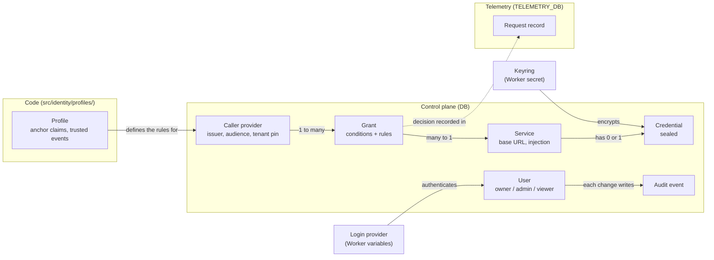

# Concepts

This page defines the terms that the code, the admin UI and the documentation use, and shows how they relate. It is for everyone, and in particular for security reviewers. Each term has exactly one meaning; the docs never use the bare word "provider".

## How the terms relate



A request flows through these terms in a fixed order. The full pipeline is in [architecture.md](architecture.md).

1. The caller sends a token. Its issuer selects a **caller provider**.
2. The **profile** of that caller provider says how to verify the token.
3. The **tenant pin** decides whether the caller belongs to your company.
4. The URL slug selects a **service**.
5. The **grants** that connect this caller provider and this service are evaluated. A grant matches when all its **conditions** hold and one of its **rules** allows the method and path. **Anchor claims** and **trusted events** constrain which grants are valid.
6. The gateway decrypts the **credential** with the **keyring**, attaches it by **injection**, and forwards the request.
7. The gateway writes a **request record**.

## Glossary

### Service

A service is one upstream API that callers reach through the gateway. It has a slug, a fixed `https` base URL, an injection, an optional credential, a timeout, an optional list of extra request headers to forward, and an optional credential check. Callers address it as `/proxy/<slug>/<path>`; the gateway appends `<path>` to the base URL and never leaves it ([I-PATH-1](threat-model.md#i-path-1)). The slug is 1 to 63 characters of `a-z`, `0-9` and `-` and cannot change. The base URL must use `https`, must not be an IP address, localhost, a `workers.dev` host or the gateway itself, and must match `ALLOWED_UPSTREAM_HOSTS` when that variable is set. The gateway checks this when the service is saved and again on every request ([I-SSRF-1](threat-model.md#i-ssrf-1)). Disabling a service refuses its requests from the next request on. IDs start with `svc_`. Admin UI: Services. Code: `src/admin/ops/services.ts`, `src/db/services.ts`.

### Credential

A credential is the secret of a service, for example an API key, a bot token or the token part of a webhook URL. The admin UI accepts it once and never shows it again; pages show only its length and last 4 characters. The gateway stores it encrypted with AES-256-GCM envelope encryption: a fresh data key per credential, wrapped by the active key of the keyring. Both layers are bound to the service ID, the base URL and the injection, so a credential only decrypts for the destination it was saved for. Changing the base URL or the injection requires entering the credential again, and a database edit of either makes decryption fail closed ([I-CRED-2](threat-model.md#i-cred-2)). The credential never appears in gateway responses, logs, audit events, the UI or exports ([I-CRED-1](threat-model.md#i-cred-1)). An optional expiry date makes the Dashboard warn 14 days before. Code: `src/crypto/envelope.ts`.

### Injection

The injection is how the gateway attaches the credential to the outbound request. There are five kinds:

| Kind | Outbound request | Typical use |
|---|---|---|
| `bearer` | `Authorization: Bearer <credential>` | Most APIs (Slack, OpenAI, GitHub) |
| `header` | `<name>: <prefix><credential>` | `x-api-key` (Anthropic) |
| `basic` | `Authorization: Basic base64(<username>:<credential>)`; without a username, the credential is `user:password` | HTTP Basic APIs |
| `query` | `?<param>=<credential>` | Legacy APIs; not recommended |
| `path` | `<base URL>/<prefix><credential>/<path>` | Webhooks (Slack, Discord) |

The gateway removes any copy of the injected header or query parameter that the caller sends, so a caller cannot replace or observe the credential ([I-INJ-1](threat-model.md#i-inj-1)). Code: `src/proxy/inject.ts`, `src/proxy/path.ts`.

### Caller provider

A caller provider is a workload-identity issuer that the gateway trusts, for example "GitHub Actions in organization 1234567". It stores the profile, the exact issuer (`iss`), the JWKS URI, the audience, the allowed signature algorithms, the maximum token age, the tenant pin and, for the `generic` profile, the anchor claims. The issuer is unique: the unverified `iss` of a token only selects which caller provider verifies it. The audience is random by default (`tokengate:` plus 26 characters), so tokens minted for other services do not work here. The gateway verifies the signature, the exact issuer, the audience, the algorithm allowlist (never `none` or `HS*`), the maximum token age and the required claims ([I-JWT-1](threat-model.md#i-jwt-1)). Disabling a caller provider refuses its tokens from the next request on. IDs start with `cpr_`. Admin UI: Caller providers. Code: `src/admin/ops/caller-providers.ts`, `src/identity/jwt.ts`.

### Profile

A profile is code-reviewed knowledge about one issuer type. There are three: `github-actions`, `gitlab-ci` and `generic`. A profile defines the default issuer and algorithms, the maximum token age limit, the claim that names the triggering event, the trusted events, the claims a tenant pin may use, the shared issuers, the anchor rules, the claims a token must carry, and the claims copied into request records. Admins choose a profile when they create a caller provider and cannot change it later. Issuers on `token.actions.githubusercontent.com` or `gitlab.com` must use their platform profile. Code: `src/identity/profiles/github-actions.ts`, `gitlab-ci.ts`, `generic.ts`.

### Tenant pin

A tenant pin is a list of exact claim conditions that every token of a caller provider must satisfy. It answers "is this caller in my company?" before any grant is read. For GitHub Actions it uses the numeric `repository_owner_id` (UI: "Allowed organization IDs") and optionally `enterprise_id`; for GitLab CI it uses `namespace_id` (UI: "Allowed group (namespace) IDs"); for `generic` it may use any claim. Shared issuers (`https://token.actions.githubusercontent.com`, `https://gitlab.com`) sign tokens for anyone on the platform, so a caller provider for them must have a tenant pin. A token outside the pin gets `401 tenant_mismatch` before the gateway reveals whether the service exists, and none of its claims are stored ([I-TEN-1](threat-model.md#i-ten-1), [I-LOG-2](threat-model.md#i-log-2)).

### Caller

A caller is a workload, for example a CI job, that presents a verified token. The gateway does not store callers. A caller exists only in request records, as the allowlisted claims of its token.

### Grant

A grant lets the callers of one caller provider whose claims match its conditions call one service with operations that match its rules. A grant can be disabled or have an expiry time; both take effect on the next request, because the gateway reads grants from D1 on every request. Grants only allow: the gateway evaluates the enabled grants in creation order, the first match wins, and a request that no grant matches gets `403` ([I-AUTHZ-1](threat-model.md#i-authz-1)). Saving a grant can show warnings, for example for a broad glob or a missing `ref_protected exact true`; the admin must acknowledge them. IDs start with `grt_`. Admin UI: Grants. Details: [policies.md](policies.md). Code: `src/policy/evaluate.ts`, `src/admin/ops/grants.ts`.

### Condition

A condition is a test on one verified claim of the token. The admin UI writes one condition per line:

```text
[not] <claim> exact|glob <value>[, <value>...]
```

`<claim>` is a literal top-level claim name: `a.b` is the claim named `a.b`, not a nested field. The values are alternatives (OR); all conditions of a grant must hold (AND). A condition compares strings, booleans (as `true` or `false`) and safe integers. A missing, null, array, object or unsafe-number claim never matches, even with `not` ([I-AUTHZ-4](threat-model.md#i-authz-4)). Code: `src/policy/conditions.ts`, `src/admin/grant-text.ts`.

### Rule

A rule is one allowed operation: a set of methods and a path glob relative to the service base URL. The admin UI writes one rule per line:

```text
<METHOD[,METHOD...]|*> /path-glob
```

The methods are `GET`, `HEAD`, `POST`, `PUT`, `PATCH`, `DELETE` and `OPTIONS`; `*` means all of them. A grant matches a request when one of its rules matches. Glob semantics (`*`, `**`, trailing `/`, `%2F`) are in [policies.md](policies.md). Code: `src/policy/glob.ts`, `src/policy/evaluate.ts`.

### Anchor claim

An anchor claim is an identity claim that a grant must pin exactly, usually an immutable ID. Each profile has anchor rules; a grant must have an `exact`, non-negated condition on every claim of at least one rule ([I-AUTHZ-2](threat-model.md#i-authz-2)):

| Profile | Anchor rules (one must be satisfied) |
|---|---|
| `github-actions` | `repository_owner_id` + `repository_id`, or `repository_owner_id` + `job_workflow_ref` |
| `gitlab-ci` | `namespace_id` + `project_id`, or `namespace_id` + `ci_config_ref_uri` |
| `generic` | any one of the caller provider's anchor claims |

Numeric IDs are used because names can be renamed and registered again by someone else. The workflow pins `job_workflow_ref` and `ci_config_ref_uri` are the exception: they are path-based, follow repository and project names, and admit every repository or project that runs the pinned file ([policies.md](policies.md#anchor-rules)). The gateway checks anchors when a grant is saved and again on every request; a grant that no longer satisfies them is skipped.

### Trusted events

Trusted events are triggering events whose workflow file and ref come from the repository itself. A grant matches other events only when it lists them with an `exact`, non-negated condition on the event claim; a glob never opts in ([I-AUTHZ-3](threat-model.md#i-authz-3)). Otherwise the request gets `403 event_not_trusted`.

| Profile | Event claim | Trusted events |
|---|---|---|
| `github-actions` | `event_name` | `push`, `workflow_dispatch`, `schedule`, `release` |
| `gitlab-ci` | `pipeline_source` | `push`, `web`, `schedule`, `api`, `trigger` |
| `generic` | none | no event check |

Events such as `pull_request_target`, `workflow_run` or GitLab `merge_request_event` can run code from outside contributors. [policies.md](policies.md) explains when an opt-in is safe.

### User

A user is a person who signs in to the admin UI. A user has a role and a status (`invited`, `active` or `disabled`):

| Role | Can |
|---|---|
| `viewer` | Read every page. No page shows secret material. |
| `admin` | Also create, change and delete caller providers, services and grants; download the configuration export. |
| `owner` | Also invite users and change roles, change settings, re-encrypt credentials, revoke sessions. |

Every admin route has an entry in the permission table, and unknown routes are denied ([I-RBAC-1](threat-model.md#i-rbac-1)). The database refuses to remove the last active owner ([I-OWNER-1](threat-model.md#i-owner-1)). IDs start with `usr_`. Admin UI: Users. Code: `src/admin/auth/rbac.ts`.

### Login provider

A login provider is how users sign in: `github` (GitHub OAuth App), `oidc` (any OpenID Connect issuer; Google is a preset of it) or `access` (Cloudflare Access). Login providers are configured with Worker variables and secrets, not in the database ([configuration.md](configuration.md)). A login provider proves a stable subject and, sometimes, verified email addresses. The gateway links a new login to a user only when that user is invited, the invitation is not expired, and the email is verified by the login provider ([I-LINK-1](threat-model.md#i-link-1)). The first owner comes from `BOOTSTRAP_OWNER_EMAILS`, at most once ([I-BOOT-1](threat-model.md#i-boot-1)). Code: `src/admin/auth/`.

### Request record

A request record is one row in `request_log` in `TELEMETRY_DB` for a call to `/proxy/...`. It holds the outcome (`allowed`, `denied` or `error`), the reason code, the HTTP status, the service, the caller provider, the matched grant, the allowlisted claims of the verified caller and the policy evaluation trace. Denied and error records of verified callers are always kept. Allowed records are sampled by the setting "Share of allowed requests to record". Rejections that happen before the token is verified and the tenant pin holds are recorded at a limited rate and without claims. Raw tokens and credentials never reach a record, and only the profile's allowlisted claims are stored ([I-LOG-1](threat-model.md#i-log-1), [I-LOG-2](threat-model.md#i-log-2)). Records are kept 14 days by default and summarized in hourly rollups. IDs start with `req_`; the same ID is in the `x-tokengate-request-id` response header. Details: [observability.md](observability.md).

### Audit event

An audit event is one row in `audit_log` in `DB` for every admin change and sign-in. It records who acted, what changed (a before and after diff without secrets), when, and from which IP address. It is written in the same database batch as the change, so a change without its audit event cannot happen ([I-AUDIT-1](threat-model.md#i-audit-1)). Each audit event is also emitted as a log line with `"type":"audit.event"` for your SIEM. Audit events are kept 365 days by default (minimum 90). IDs start with `aud_`. Admin UI: Audit log.

### Keyring

The keyring holds the key-encryption keys (KEKs) that protect credentials. It comes from one of two Worker secrets: `TOKENGATE_KEK` (one base64 32-byte key, key ID `k1`) or `TOKENGATE_KEYRING` (JSON with an active key ID and several keys, for rotation). Setting both is a configuration error. If the keyring is missing or invalid, requests that a grant allows get `503 not_configured` and credential changes are refused; admin sign-in still works ([I-CFG-1](threat-model.md#i-cfg-1)). Generate the KEK outside Cloudflare and keep it in your vault: Worker secrets cannot be read back, and losing the KEK loses every credential. Rotation: [operations/key-rotation.md](operations/key-rotation.md). Code: `src/crypto/keyring.ts`.
